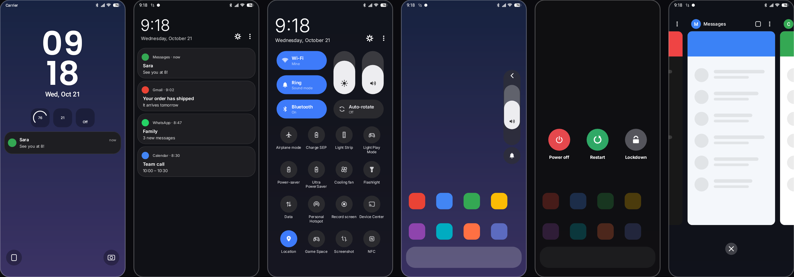
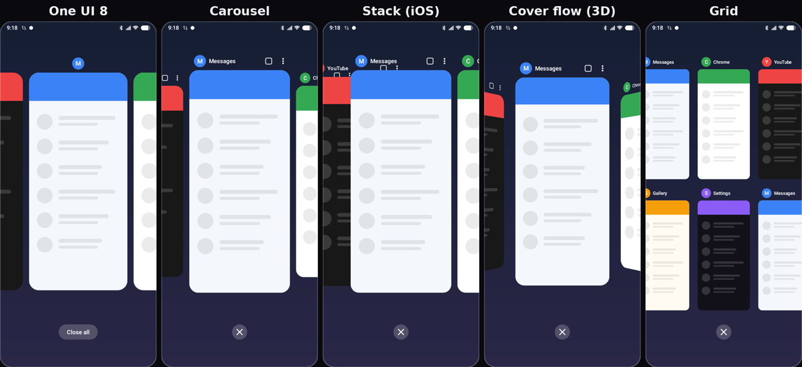

# RedMagic Tweaks

An LSPosed module and settings app for **REDMAGIC** phones. It gives RedMagic OS a Samsung **One UI 8** look and adds
about 270 tweaks: status bar, Control Center, lock screen, notifications, volume and power menu, the stock launcher and
its recent apps, Game Space, charging and fingerprint animations, boot animations and system extras.

Every tweak is **off** until you turn it on, every visual option shows a **preview before you apply it**, and a
**fail-safe** brings the phone back to stock if something goes wrong.

> Not affiliated with nubia, ZTE or REDMAGIC. REDMAGIC is their trademark.

<p align="center">
  <br>
  <em>The One UI 8 look, drawn by the app's own preview (lock screen, notifications, Control Center, volume, power menu, recent apps)</em>
</p>

## Supported phones

| Phone | Firmware | Status |
|---|---|---|
| REDMAGIC 10S Pro / 10 Pro (NX789J) | RedMagic OS 11 (Android 16) | Developed and tested on it |
| Other REDMAGIC models | RedMagic OS 10 / 11 | Not tested. Most hooks look classes up by name and skip what they can't find, so a tweak may simply do nothing |

## Requirements

- Root: [KernelSU](https://kernelsu.org), [SukiSU Ultra](https://github.com/SukiSU-Ultra/SukiSU-Ultra) or [Magisk](https://github.com/topjohnwu/Magisk)
- LSPosed: [Vector / LSPosed by JingMatrix](https://github.com/JingMatrix/Vector) (API 82 or newer)

## Install

1. Download the APK from [Releases](../../releases) and install it.
2. In LSPosed, enable **RedMagic Tweaks** and tick every app in its recommended scope (System Framework, System UI,
   launcher, Game Space apps, Settings, Theme Store and the rest). LSPosed may warn about system apps; that is expected.
3. Reboot once.
4. Open RedMagic Tweaks. The status card must say **Active**. Turn on what you like; the app offers the right restart
   (System UI, the app that changed, or a reboot) after each change.

## What's inside

| Category | Highlights |
|---|---|
| **Looks** | One tap One UI 8 look and back to stock, saved layouts you can switch between, export and import |
| **Status bar** | Clock fonts, size, colour, seconds and date · battery shapes and readouts · 16 icon packs including One UI 8 · Wi-Fi and signal styles · network speed · notification icon limit and "+N" count |
| **Quick panel** | Split shade with a One UI 8 Control Center: pills, labelled round tiles, vertical sliders, columns, gaps · classic panel grids, tile shapes and finishes |
| **Notifications** | One UI style opaque cards, corners and opacity · no automatic heads-up · keep after unlock · original app icons |
| **Lock screen & AOD** | One UI clock faces, widgets and shortcuts · hide widgets and hints · double-tap to sleep · AOD seconds and date · fingerprint icons and animations |
| **Volume & power** | One UI 8 volume panel and power menu · slider styles · no high-volume warning · volume boost · volume in Do Not Disturb |
| **Charging & battery** | Charging animations (stock, collab and four originals) · import your own frames · charging readout on the lock screen · ultra power saving · charge separation |
| **Display & performance** | Auto refresh rate up to 165 Hz · force refresh rate per app · screen timeout 30 min / never · small windows for every app |
| **Home, drawer & recents** | Horizontal paged app drawer with your own order and folders · grid, dock and labels · **recent apps styles: One UI 8, carousel, stack, cover flow, grid** |
| **Gaming** | Game Assist in every app · macros and combos in any game · Super Resolution with Diablo mode · key mapping and fan light options |
| **Fonts, themes & boot** | One UI style System UI font (Inter) · lock clock font import · boot animations (RisingOS set plus your own) · Theme Store collaboration packs |
| **System & apps** | Settings extras · installer · gestures · NFC · app cloning · screen cast · airplane mode keeps Wi-Fi / Bluetooth · block ZTE telemetry |
| **Advanced** | Screenshots in protected apps, touches through overlays, no thermal throttling, phantom-process limit off and other tweaks that need care |

<p align="center">
  <br>
  <em>Recent apps styles for the stock launcher</em>
</p>

## If something goes wrong

RedMagic Tweaks has a fail-safe:

- **Safe mode** stops every tweak at once and keeps your settings, so turning it off brings everything back.
- **Crash guard**: if System UI, the launcher or another hooked app crashes 3 times within 5 minutes with the tweaks
  loaded, that app runs stock until you turn its tweaks back on in the app.
- **Boot-loop guard**: if the phone fails to finish booting twice in a row, the framework tweaks are skipped.
- **From outside the app**, any one of these works:
  - `su -c setprop persist.redmagictweaks.safe 1` from ADB or Termux, then reboot (set it to `0` to turn safe mode off)
  - untick RedMagic Tweaks in LSPosed and reboot
  - boot into your root manager's safe mode, which turns off LSPosed and every module

## Building

```sh
./gradlew assemblePublicRelease
```

The APK lands in `app/build/outputs/apk/public/release/`. Without a signing key it is signed with the debug key. CI
(`.github/workflows/build.yml`) builds every push and publishes a release for every `v*` tag. `Previews` renders the
app's look previews with Robolectric so drawings can be checked without a phone.

Source layout: `app/src/main/java/com/hammad/redmagictweaks/` holds the settings app and the feature catalogue,
`xposed/` the hooks (`Entry` dispatches per app, one `*Hooks` class per app), `*Art` classes the drawing code shared by
the hooks and the previews.

## Credits

| Who | What RedMagic Tweaks uses |
|---|---|
| **Hammad Yasin** ([HammadY2346](https://github.com/HammadY2346)) | Author: NX789J research, the module and app, the One UI 8 work |
| **EliteDarkKaiser / Austin Young**, [nubia-ly](https://github.com/austineyoung2000/nubia-ly) | Quick Settings, status bar, clock, icon, notification, volume and power menu backends; fingerprint and charging catalogue; boot animation set. Used with permission |
| [RisingOS Revived](https://github.com/RisingOS-Revived) | Battery shapes, Wi-Fi and signal artwork, fingerprint icons and animations (Apache 2.0, notices in `app/src/main/assets/licenses`), boot animations (via nubia-ly) |
| **RedMagic Helper** by 酷安@卒迹 | Game Space hook targets (Game Assist everywhere, macros, Super Resolution with Diablo, combo and AI trigger speed). RedMagic Tweaks re-implements these hooks |
| Icon pack authors | Acherus, Aurora, Circular, Filled, Gradicon, Kai, Lorn, Nostalgic, OxygenOS, Outline, Plumpy, Pavlova UI, Rounded, Sam, Victor, Xperia (via nubia-ly) |
| [Iconify](https://github.com/Mahmud0808/Iconify) by Mahmud0808 | Inspiration for an organised customisation app |
| [Inter](https://rsms.me/inter/) (Rasmus Andersson), [Poppins](https://github.com/itfoundry/Poppins) (Indian Type Foundry) | System UI font and One UI clock digits, SIL Open Font License 1.1 |
| [Vector / LSPosed](https://github.com/JingMatrix/Vector), [Xposed API](https://api.xposed.info/) | Hook framework |
| Android Open Source Project, Material Components for Android | Platform and UI library, Apache License 2.0 |

Samsung One UI is design inspiration only: the One UI 8 icons, clock faces and layouts are redrawn, no Samsung files
are shipped. Artwork and trademarks belong to their owners.

## License

[GNU General Public License v3.0](LICENSE). Bundled third-party assets keep their own licences (see
`app/src/main/assets/licenses`).
