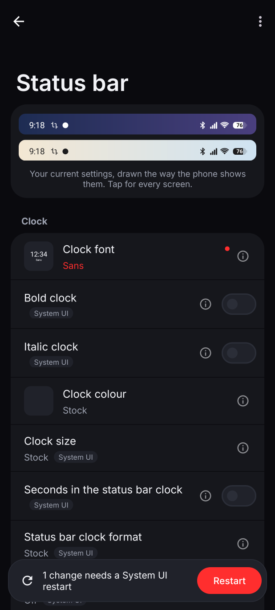

# RedMagic Tweaks

An LSPosed module and settings app for **REDMAGIC** phones. About 315 tweaks for the status bar, Control Center,
lock screen and always-on display, notifications, volume and power menu, the stock launcher and its recent apps,
Game Space, charging and fingerprint animations, boot animations and system extras.

Every tweak is **off** until you turn it on, every visual option shows a **preview before you apply it**, Detailed mode
explains every setting in place, and a **fail-safe** brings the phone back to stock if something goes wrong.

> Not affiliated with nubia, ZTE or REDMAGIC. REDMAGIC is their trademark.

<p align="center">
  
</p>

**Latest: [v1.2.0](../../releases/latest)** · English and Русский

## What's new in v1.2

- **Русский язык**: ⋮ → **App language** switches the whole app to Russian. Every sentence is Russian before the screen is drawn.
- **The One UI layouts are back**: the one-tap One UI 8 look, One UI 8 Control Center, lock screen and AOD clocks,
  volume panel, power menu, System UI font, and the drawer's own app order.
- **Gaming**: frame interpolation in every game with its target refresh rate, game full screen, Game view, every Game
  Space plugin in every game, launch boost, Game Assist defer, Game Lab AI speed.
- **Lock screen & AOD**: your own video on the lock screen and AOD, AOD clock position.
- **Battery & charging**: battery health page, charge separation at 100 %, the China firmware's charging animations
  (golden staff, CAMELLYA pink lotus, blue ring, crystal cube) and charging that follows the theme.
- **Launcher**: icon packs (installed, from a zip / theme file, or two built-in One UI 8 sets), icon shape, icon size, label size, hidden labels,
  folder columns and rows. Icon pack and icon shape also apply on third-party launchers (tick One UI Home in LSPosed).
- **Android 15 China (10.5.6 / 10.5.8)**: brightness bar shape and Game Space Free display.
- **System**: Google international mode.

## Supported phones

| Phone | Firmware | Status |
|---|---|---|
| REDMAGIC 10S Pro / 10 Pro (NX789J) | **Global / EEA RedMagic OS 11** (Android 16) | Supported. Every hook is checked against the global firmware (11.0.4) |
| REDMAGIC 10S Pro / 10 Pro (NX789J) | China RedMagic OS 11.0.11 (Android 16) | Works (the app was developed on it). The build offers the same tweaks as on global; the few China-only extras (Phone Manager, Magic Voice, screen cast extras, the Chinese installer) are not included |
| Other REDMAGIC models | RedMagic OS 10 / 11 | Not tested. Most hooks look classes up by name and skip what they can't find, so a tweak may simply do nothing |

## Requirements

- Root: [KernelSU](https://kernelsu.org), [SukiSU Ultra](https://github.com/SukiSU-Ultra/SukiSU-Ultra) or [Magisk](https://github.com/topjohnwu/Magisk)
- LSPosed: [Vector / LSPosed by JingMatrix](https://github.com/JingMatrix/Vector) (API 82 or newer)

## Install

1. Download the APK from [Releases](../../releases) and install it.
2. In LSPosed, enable **RedMagic Tweaks** and tick every app in its recommended scope (System Framework, System UI,
   launcher, Game Space apps, Settings, Theme Store and the rest). LSPosed may warn about system apps; that is expected.
3. Reboot once.
4. Open RedMagic Tweaks. The status card must say **Active**. Turn on what you like; the app offers the right restart
   (System UI, the app that changed, or a reboot) after each change.

## What's inside

| Category | Highlights |
|---|---|
| **Looks** | One UI 8 look or back to stock in one tap, saved layouts you can switch between, export and import |
| **Status bar** | Clock fonts, size, colour, seconds and date · battery shapes and readouts · 16 icon packs · Wi-Fi and signal styles · network speed · notification icon limit and "+N" count |
| **Quick panel** | Split shade (Control Center) with the One UI 8 layout, columns, gaps, slider position and style · tile and slider colours · classic panel grids, tile shapes and finishes |
| **Notifications** | Card finishes, corners and opacity · no automatic heads-up · keep after unlock · original app icons |
| **Lock screen & AOD** | One UI lock and AOD clocks · your own video on the lock screen and AOD · AOD clock position · clock and date colours, size, position and rotation · hide widgets and hints · double-tap to sleep · AOD seconds, date, brightness and burn-in protection |
| **Fingerprint** | Unlock animations (stock, collab and originals) · import your own frames · idle icon styles, colours and size · collaboration styles |
| **Volume & power** | Volume bar width, height, shape, colours and gradients, icon place, level number, side, position and timeout · power menu button finish, position, layout and dim · no high-volume warning · volume in Do Not Disturb |
| **Charging & battery** | Charging animations (stock, collab and four originals) · import your own frames · charging readout on the lock screen · ultra power saving · charge separation (also at 100 %) · battery health page |
| **Display & performance** | Auto refresh rate up to the panel's top rate (144 Hz stock, 165 Hz with a panel mod on Android 16) · force refresh rate in every app, 60 Hz in video apps · screen timeout 30 min / never · small windows for every app |
| **Home, drawer & recents** | Icon packs (also from a zip / theme file), icon shape and size · horizontal paged app drawer with your own order · grid, dock, labels and folders · **recent apps styles: carousel, stack, cover flow, grid, list** |
| **Gaming** | Frame interpolation in every game · game full screen · Game view · Game Assist in every app · macros and combos in any game · Super Resolution with Diablo mode · key mapping and fan light options |
| **Fonts, themes & boot** | Lock clock font import · boot animations (RisingOS set plus your own) · Theme Store collaboration packs |
| **System & apps** | Settings extras · Google international mode · gestures · NFC · app cloning · airplane mode keeps Wi-Fi / Bluetooth · block ZTE telemetry |
| **Advanced** | Screenshots in protected apps, no thermal throttling of the refresh rate, phantom-process limit off and other tweaks that need care |

## If something goes wrong

RedMagic Tweaks has a fail-safe:

- **Safe mode** stops every tweak at once and keeps your settings, so turning it off brings everything back.
- **Crash guard**: if System UI, the launcher or another hooked app crashes 3 times within 5 minutes with the tweaks
  loaded, that app runs stock until you turn its tweaks back on in the app.
- **Boot-loop guard**: if the phone fails to finish booting twice in a row, the framework tweaks are skipped.
- **From outside the app**, any one of these works:
  - `su -c setprop persist.redmagictweaks.safe 1` from ADB or Termux, then reboot (set it to `0` to turn safe mode off)
  - untick RedMagic Tweaks in LSPosed and reboot
  - boot into your root manager's safe mode, which turns off LSPosed and every module
- **Logs**: turn on Record logs in the app, reproduce the problem, then Share as .txt and attach it to an issue.

## Building

```sh
./gradlew assemblePublicRelease
```

The APK lands in `app/build/outputs/apk/public/release/`. Without a signing key it is signed with the debug key. CI
(`.github/workflows/build.yml`) builds every push and publishes a release for every `v*` tag, or when it is run by hand
from the Actions page with a version in "release". `Previews` renders the
app's look previews with Robolectric so drawings can be checked without a phone.

Source layout: `app/src/main/java/com/hammad/redmagictweaks/` holds the settings app and the feature catalogue,
`xposed/` the hooks (`Entry` dispatches per app, one `*Hooks` class per app), `*Art` classes the drawing code shared by
the hooks and the previews.

## Credits

| Who | What RedMagic Tweaks uses |
|---|---|
| **Hammad Yasin** ([HammadY2346](https://github.com/HammadY2346)) | Author: NX789J research, the module and app |
| **EliteDarkKaiser / Austin Young**, [nubia-ly](https://github.com/austineyoung2000/nubia-ly) | Quick Settings, status bar, clock, icon, notification, volume and power menu backends; fingerprint and charging catalogue; boot animation set. Used with permission |
| [RisingOS Revived](https://github.com/RisingOS-Revived) | Battery shapes, Wi-Fi and signal artwork, fingerprint icons and animations (Apache 2.0, notices in `app/src/main/assets/licenses`), boot animations (via nubia-ly) |
| **RedMagic Helper** by 酷安@卒迹 | Game Space hook targets (Game Assist everywhere, macros, Super Resolution with Diablo, combo and AI trigger speed). RedMagic Tweaks re-implements these hooks |
| Icon pack authors | Acherus, Aurora, Circular, Filled, Gradicon, Kai, Lorn, Nostalgic, OxygenOS, Outline, Plumpy, Pavlova UI, Rounded, Sam, Victor, Xperia (via nubia-ly) |
| [Iconify](https://github.com/Mahmud0808/Iconify) by Mahmud0808 | Inspiration for an organised customisation app |
| [Inter](https://rsms.me/inter/) (Rasmus Andersson), [Poppins](https://github.com/itfoundry/Poppins) (Indian Type Foundry) | The app's font, SIL Open Font License 1.1 |
| [Vector / LSPosed](https://github.com/JingMatrix/Vector), [Xposed API](https://api.xposed.info/) | Hook framework |
| Android Open Source Project, Material Components for Android | Platform and UI library, Apache License 2.0 |

Artwork and trademarks belong to their owners.

## License

[GNU General Public License v3.0](LICENSE). Bundled third-party assets keep their own licences (see
`app/src/main/assets/licenses`).
